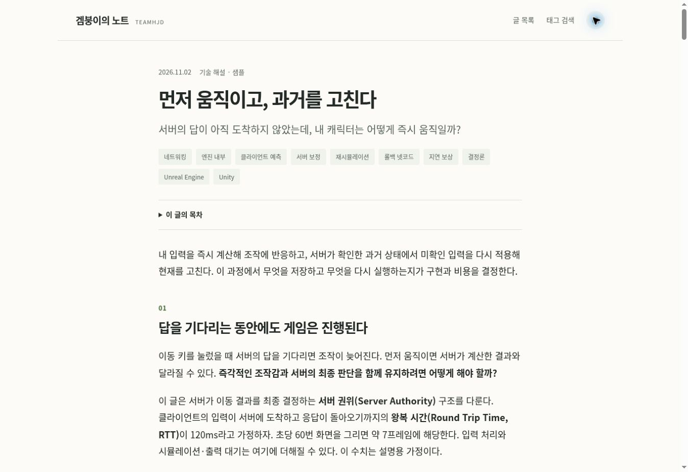
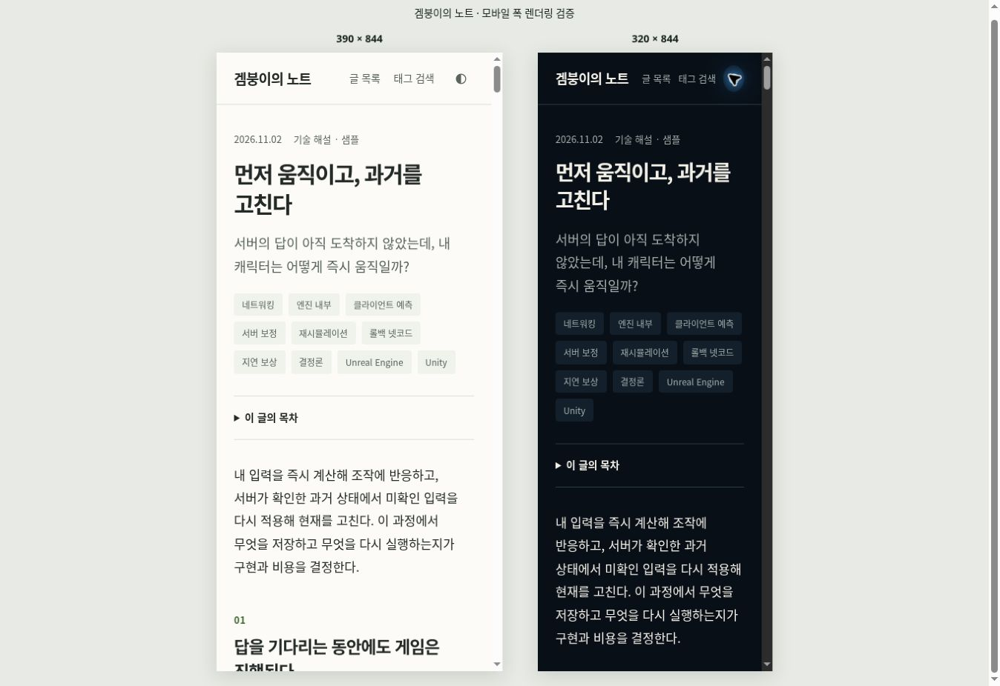

# 겜붕이의 노트 화면 검증

## 2026-11-03 — TeamHJD 로고와 일일 원고 계약

Windows / PowerShell / Node.js 20.13.1 / 프로젝트 로컬 Pandoc 3.13. Codex in-app Chromium에서 실제 로컬 페이지를 렌더링했다.

- 1280×720, 390×844, 320×844 화면에서 가로 넘침 없음. 작은 화면의 가용 문서 폭은 스크롤바를 제외한 375px·305px였다.
- 원본 TeamHJD PNG와 복사본의 바이트·SHA256 일치. 실제 로고 SVG에도 동일 원본 PNG가 내장됨을 검사했다. 로고는 데스크톱 210px, 모바일 175px·162px. 탭은 원본 로켓 SVG를 참조한다.
- 어두운 화면과 320px 밝은 화면에서 작은 로고·서명과 본문을 확인했다. 큰 로고 삽화는 제품 화면에서 제외했다.
- 실제 기사 이동, 목차 펼치기, 그림 확대·닫기 통과. 그림 3개, KaTeX 수식 2개 표시. 모바일 코드 블록은 본문 폭 안에서 스크롤한다.
- `reconciliation` 검색은 글 1개, `C++`는 글 0개. 특수 기호를 보존한다.
- 콘텐츠 계약 검사 10개 통과, 실제 샘플 validate/build 통과. 정적 HTML 4개·로컬 파일 링크 79개에서 누락 0개. ZIP 7개 항목의 CRC 정상. standalone Markdown의 절대 이미지 URL, RSS·사이트맵 XML, 샘플이 빠진 published 매니페스트를 검사했다.
- 기존 메일 모의 검사의 파일 저장 경로는 Windows 디렉터리 fsync에서 EPERM, symlink는 권한 오류였다. 이를 메일 제공자 오류로 해석하지 않았고 기록 보장을 제거하지 않았다. 해당 CLI의 지원 환경은 영구 디스크가 있는 Linux/macOS다. Linux GitHub CI에 기존 19개 검사와 새 콘텐츠 검사 10개를 함께 연결했다. CI의 실제 결과는 PR 체크를 따른다.

이번 스크린샷은 ignored `qa/screenshots/20261103-*.jpg`에 저장했다. 실제 휴대전화·Safari 검증, 운영 도메인 배포, 브라우저의 파일 저장 완료, 이메일 발송·수신은 이번 로컬 검증에 포함되지 않는다.

2026-11-02 한국 시간 기준. 완성된 정적 빌드를 관리형 미리보기에서 열고 Chrome의 실제 렌더링과 UI 조작을 확인했다.

## 화면

| 대상 | 확인 조건 | 결과 |
| --- | --- | --- |
| 데스크톱 | 1363 × 936 뷰포트 | 본문 18px, 페이지 가로 넘침 없음 |
| 모바일 폭 | 390 × 844 iframe 뷰포트 | 본문 17px, 문서 폭 375px = 스크롤바를 뺀 가용 폭 |
| 작은 모바일 폭 | 320 × 844 iframe 뷰포트 | 본문 17px, 문서 폭 305px = 스크롤바를 뺀 가용 폭 |

모바일 검증은 실제 Chrome 안의 좁은 iframe 뷰포트에서 수행했다. 실제 iPhone·Android 기기, Safari, 터치 제스처를 검사한 결과는 아니다. `responsive.html`을 미리보기 출력에 임시로 복사해 같은 확인 화면을 열 수 있다. 이 QA 페이지는 제품 빌드에 포함하지 않는다.

## 확인한 동작

- 실제 기사 이동, 목차 펼치기와 본문 앵커 이동.
- `서버 보정`, `reconciliation`, `UE5` 검색 결과가 실제 글 1개와 연결됨.
- `C++` 검색은 특수문자를 보존하고 연결된 글 0개를 표시함. 검색어는 URL에 유지됨.
- 그림 확대 대화상자 열기·닫기, 원본 이미지 링크 표시.
- 코드 블록은 페이지를 넓히지 않고 내부에서 스크롤됨. 390px 화면에서 코드 가용 폭 327px, 내용 폭 512px이며 키보드 이동 후 `scrollLeft=80`을 확인함.
- 표는 본문 안의 별도 스크롤 영역에 들어감. 수식 2개는 모바일 본문 폭 안에 표시됨.
- 밝은·어두운 화면 전환, 최종 사이트 이름 표시. 320px에서 제목과 메뉴가 한 줄에 들어가도록 간격을 조정함.

## 파일과 운영 경계

정적 링크·목차 앵커 검사는 통과했다. 생성된 ZIP의 CRC와 포함 파일, 개별 Markdown과 원문의 일치도 확인했다. 다만 이 클라우드 브라우저에서는 다운로드 이벤트가 제한 시간 안에 완료되지 않아 **브라우저 저장까지 성공했다고 판정하지 않았다**. 배포 환경에서 Markdown·ZIP 버튼의 실제 저장을 확인해야 한다.

GitHub 소스 보존과 화면 검증은 배포 완료를 뜻하지 않는다. 사용자 도메인의 DNS, Cloudflare 수신자 검증, 실제 메일 발송은 별도의 운영 연결 단계다.
